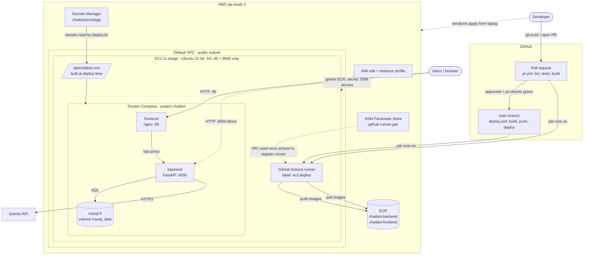

# Chatbot – base project

| Path | What |
|---|---|
| `backend/` | FastAPI, MVC: `models/` `schemas/` `services/` `controllers/` (routers); settings in `app/core/config.py` |
| `webs/` | React (Vite), MVC: `models/` `services/` `controllers/` (hooks) `views/` |
| `iac/` | Terraform: `modules/{ecr,iam,network,secrets,runner}` + `environments/prod` (`variables.tf` here) |
| `deploy/` | `docker-compose.yml`, `deploy.sh`, `env/prod.env` (non-secret vars) |
| `.github/workflows/` | `pr.yml` (checks on PR), `deploy.yml` (build → ECR → deploy on merge) |

## Architecture

Everything runs in `ap-south-1` (default VPC, one public subnet). Terraform is run from a developer machine; the EC2 instance is both the GitHub Actions runner and the production host.



| Resource | Created by | Notes |
|---|---|---|
| EC2 t2.xlarge, 60 GB encrypted gp3 | `modules/runner` | Docker + GitHub runner installed by user data; IMDSv2 only; no SSH, use SSM Session Manager |
| Security group | `modules/network` | Inbound 80 and 8000 (`app_ingress_cidrs`), all outbound |
| ECR repos (backend, frontend) | `modules/ecr` | Scan on push, keep last 10 images |
| IAM role + instance profile | `modules/iam` | ECR push/pull, read one secret, read the PAT parameter, SSM core |
| Secrets Manager secret | `modules/secrets` | Random MySQL passwords; add other secrets as JSON keys |
| SSM SecureString `github-runner-pat` | created by hand | Not in Terraform state |

## Flow

1. **PR to `main`** → `pr.yml` on the self-hosted runner: ruff + pytest, vitest + build, docker build of both images. `pr-checks` is the single required status.
2. Branch protection requires `pr-checks` + 1 approval.
3. **Merge** → `deploy.yml`: build, push to ECR (`<sha>` + `latest`), then `deploy/deploy.sh` builds the `.env`, pulls images, `docker compose up -d` (frontend **:80**, backend **:8000**), health-checks, then prunes old containers/images/build cache. The MySQL volume is never removed.

## Configuration: where each value lives

| Kind | Source | Example |
|---|---|---|
| Secrets | AWS Secrets Manager `chatbot/prod/app` (JSON), created by Terraform with random passwords | `MYSQL_ROOT_PASSWORD`, `MYSQL_PASSWORD` |
| Non-secret vars | `deploy/env/prod.env` (in git) | `MYSQL_HOST`, `LOG_LEVEL` |
| Infra vars | `iac/environments/prod/variables.tf` (+ `terraform.tfvars`) | region, instance type, CIDRs, secret name |
| Pipeline vars | GitHub repo *variables* (optional) | `AWS_REGION` (default `ap-south-1`), `APP_SECRET_NAME` |
| Local dev | `backend/.env` (copy `.env.example`) | |

At deploy time `deploy.sh` writes `/opt/chatbot/.env` = `prod.env` + every key in the Secrets Manager JSON + `ECR_REGISTRY` + `IMAGE_TAG`. Compose reads it and passes an explicit list to the backend, which `app/core/config.py` (pydantic-settings) loads. **No secrets are stored in GitHub.**

To add a new secret: put the key in the Secrets Manager JSON (console/CLI), add it to the `environment:` of the service in `docker-compose.yml`, and add a field in `config.py`. To add a non-secret: same, but in `prod.env`.

## Setup, step by step

### 1. GitHub
1. Create a **private** repo (e.g. `chatbot`) at github.com/new, no README.
2. In this folder: `git init -b main && git add . && git commit -m "Initial scaffold"`, then
   `git remote add origin https://github.com/<owner>/chatbot.git && git push -u origin main`.
   (The first push to `main` triggers `deploy.yml`, which will queue until the runner exists. Alternatively push to a branch first and merge after step 3.)
3. Create a **fine-grained PAT**: Settings → Developer settings → Fine-grained tokens, scoped to this repo only, permission **Administration: Read and write** (needed to mint runner registration tokens).

### 2. AWS (region `ap-south-1`)
1. Install and configure the AWS CLI and Terraform (`aws configure`, with permissions to create EC2/IAM/ECR/Secrets Manager/SSM).
2. Store the PAT (kept out of Terraform state):
   ```
   aws ssm put-parameter --region ap-south-1 --name /chatbot/github-runner-pat --type SecureString --value <PAT>
   ```
3. Provision:
   ```
   cd iac/environments/prod
   cp terraform.tfvars.example terraform.tfvars    # set github_repo = "owner/chatbot"
   terraform init && terraform apply
   ```
   Creates ECR repos, the Secrets Manager secret (random MySQL passwords), the IAM role, the security group and the t2.xlarge, which installs Docker and registers as runner `ec2-deploy`.
4. Wait ~3–5 min, then check GitHub → Settings → Actions → Runners shows it **Idle**. Debug via `aws ssm start-session --target <instance_id>` and `/var/log/cloud-init-output.log`.

### 3. Protect `main`
`scripts/protect-main.sh owner/chatbot` (needs `gh auth login`; branch protection on private repos requires a paid GitHub plan). Or Settings → Branches → require PR, 1 approval, status check `pr-checks`.

### 4. Try it
1. `git checkout -b test-pr`, change something, push, open a PR → watch `PR checks`.
2. Approve and merge → watch `Build and deploy`.
3. Open `http://<public_ip>` (the `app_url` Terraform output) and `http://<public_ip>:8000/api/health`.

## Next steps worth doing
- Put Terraform state in S3 (uncomment the backend block in `versions.tf`).
- Add an Elastic IP (the public IP changes if the instance is stopped) and a domain + HTTPS (e.g. Caddy/nginx with Let's Encrypt) before real users.
- Restrict `app_ingress_cidrs`; consider closing 8000 publicly once the frontend proxy is enough.
- Back up MySQL (cron `mysqldump` to S3, or EBS snapshots); the data lives only on this instance.
- Add Alembic migrations (tables are currently created on startup).
- Use a separate runner for PR checks, and pin the runner version/AMI.

## Local dev

```
cd backend && cp .env.example .env && pip install -r requirements-dev.txt && pytest && uvicorn app.main:app --reload
cd webs && npm install && npm test && npm run dev      # proxies /api to :8000
```

## Caveats

- A self-hosted runner executes PR code on the same box that runs production. Fork PRs are skipped; keep the repo private or restrict who can open PRs.
- The generated passwords are in Terraform state (random_password). Keep state private/encrypted (S3 backend with encryption).
- Single instance: brief downtime per deploy; rollback = redeploy an older SHA.
- Secret values must not contain newlines (the `.env` is line-based).
